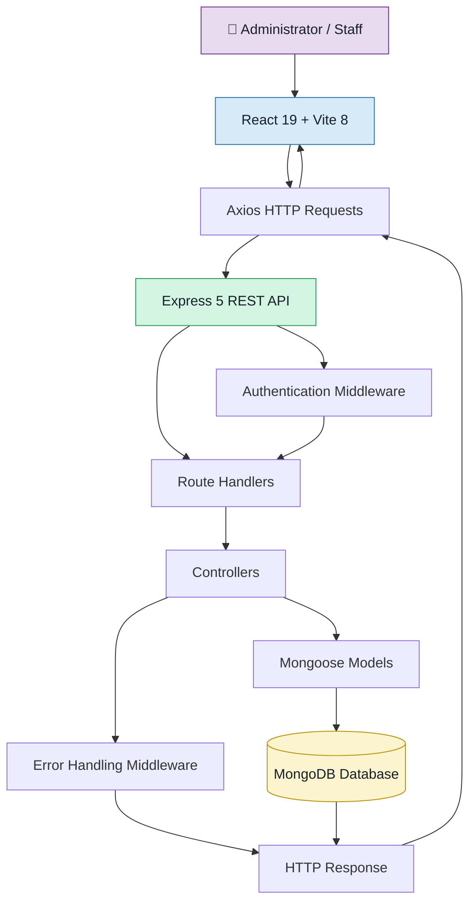

<div align="center">

# 🎓 College Student Management System

### A Modern Full-Stack MERN Application for Student Administration

**Manage student records, monitor academic statistics, and simplify college administration through a responsive web interface and RESTful APIs.**

<br/>

<a href="https://github.com/KishanJangid5/MERN-STACK-College-Student-Management-System">
  
</a>
<a href="https://react.dev/">
  
</a>
<a href="https://vite.dev/">
  
</a>
<a href="https://nodejs.org/">
  
</a>
<a href="https://expressjs.com/">
  
</a>
<a href="https://www.mongodb.com/">
  
</a>

<br/><br/>

<a href="#-key-features">Features</a> •
<a href="#-technology-stack">Tech Stack</a> •
<a href="#-architecture">Architecture</a> •
<a href="#-installation--setup">Installation</a> •
<a href="#-rest-api-reference">API Reference</a>

<br/>

**Developed by [Kishan Jangid](https://github.com/KishanJangid5)**

</div>

---

## 📌 Project Overview

The **College Student Management System** is a full-stack web application developed using the **MERN stack** to simplify student administration and academic record management.

The application combines a React-based frontend with a Node.js and Express backend, using MongoDB for data storage. It provides an interface for managing student information, viewing dashboard statistics, searching and filtering records, and performing administrative operations through RESTful APIs.

Designed with modular components and environment-based configuration, the project demonstrates the integration of frontend development, backend engineering, database management, and authentication in a single application.

### 🎯 Project Goals

- Simplify student record management through a centralized interface.
- Provide essential student statistics through a dashboard.
- Implement complete CRUD operations for student records.
- Integrate a React frontend with a RESTful backend.
- Implement authentication using JSON Web Tokens (JWT).
- Apply database modeling, input validation, and secure configuration practices.

---

## ✨ Key Features

<table>
  <tr>
    <td width="50%" valign="top">
      <h3>📊 Dashboard</h3>
      View student statistics and course distribution through a centralized dashboard.
      <br/><br/>
      <strong>Highlights:</strong> Academic overview and student statistics.
    </td>
    <td width="50%" valign="top">
      <h3>👨‍🎓 Student Management</h3>
      Create, view, update, and delete student records using dedicated management operations.
      <br/><br/>
      <strong>Highlights:</strong> Complete CRUD functionality.
    </td>
  </tr>
  <tr>
    <td width="50%" valign="top">
      <h3>🔎 Search & Filtering</h3>
      Find relevant student records using supported search parameters and filters.
      <br/><br/>
      <strong>Highlights:</strong> Search by supported criteria and filter by course or status.
    </td>
    <td width="50%" valign="top">
      <h3>↕️ Sorting</h3>
      Organize student records using supported sorting fields and ordering options.
      <br/><br/>
      <strong>Highlights:</strong> Configurable record ordering.
    </td>
  </tr>
  <tr>
    <td width="50%" valign="top">
      <h3>🔐 Authentication</h3>
      Support administrator or staff registration, login, and authenticated profile retrieval.
      <br/><br/>
      <strong>Highlights:</strong> JWT-based authentication and password hashing with bcrypt.
    </td>
    <td width="50%" valign="top">
      <h3>🛡️ Validation & Error Handling</h3>
      Organize backend validation and database error handling through dedicated middleware and controllers.
      <br/><br/>
      <strong>Highlights:</strong> Structured backend logic and error handling.
    </td>
  </tr>
  <tr>
    <td width="50%" valign="top">
      <h3>📱 Responsive Interface</h3>
      Use a React interface organized into reusable components, pages, and shared application context.
      <br/><br/>
      <strong>Highlights:</strong> Component-based UI and modal dialogs.
    </td>
    <td width="50%" valign="top">
      <h3>🔌 RESTful API</h3>
      Connect frontend operations to backend endpoints for authentication, student records, and statistics.
      <br/><br/>
      <strong>Highlights:</strong> API integration using Axios.
    </td>
  </tr>
</table>

---

## 🛠️ Technology Stack

The application uses the MERN architecture, supplemented by supporting libraries for authentication, API communication, and frontend development.

| Layer | Technology | Purpose |
|:---|:---|:---|
| Frontend |  React 19 | Component-based user interface |
| Frontend Tooling |  Vite 8 | Development server and frontend build tooling |
| Styling |  CSS | Interface styling and responsive layouts |
| API Communication |  Axios | HTTP requests between frontend and backend |
| Backend Runtime |  Node.js | JavaScript runtime for server-side execution |
| Backend Framework |  Express 5 | REST API and request handling |
| Database |  MongoDB | NoSQL document database |
| ODM | Mongoose 9 | MongoDB schemas, models, and database operations |
| Authentication | JWT | Token-based authentication |
| Password Security | bcrypt | Password hashing |
| Configuration | Environment variables | Environment-specific application settings |
| Version Control |  Git & GitHub | Source control and repository hosting |

### 🔗 Official Technology Resources

| Technology | Documentation |
|:---|:---|
| React | [Official Documentation](https://react.dev/) |
| Vite | [Official Documentation](https://vite.dev/) |
| Node.js | [Official Documentation](https://nodejs.org/docs/latest/api/) |
| Express | [Official Documentation](https://expressjs.com/) |
| MongoDB | [Official Documentation](https://www.mongodb.com/docs/) |
| Mongoose | [Official Documentation](https://mongoosejs.com/docs/) |
| Axios | [Official Documentation](https://axios-http.com/) |
| JSON Web Tokens | [JWT Introduction](https://jwt.io/introduction) |

---

## 🏗️ Architecture

The application follows a client-server architecture in which the React frontend communicates with the Express backend through HTTP requests. The backend processes requests, applies authentication and validation where configured, and interacts with MongoDB through Mongoose.



### 🔄 Request Lifecycle

1. A user interacts with the React interface.
2. Axios sends an HTTP request to the backend API.
3. Express routes the request to the appropriate handler.
4. Configured authentication middleware verifies protected requests.
5. Controllers perform the required application logic and database operations through Mongoose.
6. The backend returns an HTTP response to the frontend.
7. The interface displays the returned information or handles the reported error.

---

## 📂 Project Structure

The repository separates frontend and backend code to keep UI components, API logic, database models, and server configuration organized.

```text
FSD Project/
│
├── backend/
│   ├── config/
│   │   └── db.js
│   │
│   ├── controllers/
│   │   ├── authController.js
│   │   └── studentController.js
│   │
│   ├── middleware/
│   │   ├── authMiddleware.js
│   │   └── errorMiddleware.js
│   │
│   ├── models/
│   │   ├── Student.js
│   │   └── User.js
│   │
│   ├── routes/
│   │   ├── authRoutes.js
│   │   └── studentRoutes.js
│   │
│   ├── .env.example
│   ├── package.json
│   └── server.js
│
├── frontend/
│   ├── public/
│   │
│   ├── src/
│   │   ├── components/
│   │   ├── context/
│   │   ├── pages/
│   │   ├── services/
│   │   ├── App.jsx
│   │   ├── App.css
│   │   ├── index.css
│   │   └── main.jsx
│   │
│   ├── .env.example
│   ├── index.html
│   ├── package.json
│   └── vite.config.js
│
├── .gitignore
└── README.md
```

### 📁 Important Directories

| Directory / File | Responsibility |
|:---|:---|
| `backend/config/` | Database connection configuration |
| `backend/controllers/` | Authentication and student-related application logic |
| `backend/middleware/` | Authentication and error handling |
| `backend/models/` | Mongoose models for users and students |
| `backend/routes/` | Authentication and student API route definitions |
| `backend/server.js` | Backend server entry point |
| `frontend/src/components/` | Reusable interface components |
| `frontend/src/context/` | Shared application state and context |
| `frontend/src/pages/` | Application pages |
| `frontend/src/services/` | Frontend service and API communication logic |
| `frontend/src/App.jsx` | Main React application component |
| `frontend/vite.config.js` | Vite configuration |

---

## ⚙️ Installation & Setup

Follow these steps to run the project locally on your computer.

### Prerequisites

Install the following software before proceeding:

| Requirement | Purpose | Download |
|:---|:---|:---|
| Node.js and npm | Run the frontend and backend | [Download Node.js](https://nodejs.org/) |
| MongoDB Community Server | Run a local MongoDB database | [Download MongoDB](https://www.mongodb.com/try/download/community) |
| Git | Clone the repository | [Download Git](https://git-scm.com/) |
| Code Editor | Edit and run the project | [Visual Studio Code](https://code.visualstudio.com/) |

**Database alternative:** You can use MongoDB Atlas instead of installing a local MongoDB server. Atlas provides a hosted database, while MongoDB Compass is a graphical application for connecting to and managing MongoDB databases.

### Step 1: Clone the Repository

Open a terminal and execute:

```bash
git clone https://github.com/KishanJangid5/MERN-STACK-College-Student-Management-System.git
```

Navigate into the project directory:

```bash
cd MERN-STACK-College-Student-Management-System
```

### Step 2: Configure the Backend

Navigate to the backend directory:

```bash
cd backend
```

Install the backend dependencies:

```bash
npm install
```

Create a `.env` file inside the `backend/` directory. Use the existing `.env.example` as a reference.

Example local development configuration:

```ini
PORT=5000
MONGODB_URI=mongodb://127.0.0.1:27017/collegeDB
JWT_SECRET=replace_with_a_secure_random_secret
JWT_EXPIRES_IN=7d
CLIENT_URL=http://localhost:5173
NODE_ENV=development
```

**Configuration notes:**

- `PORT` specifies the backend server port.
- `MONGODB_URI` specifies the MongoDB connection string.
- `JWT_SECRET` must contain a strong, randomly generated secret.
- `JWT_EXPIRES_IN` defines the token expiration duration.
- `CLIENT_URL` specifies the frontend origin used for cross-origin configuration.
- `NODE_ENV` identifies the current runtime environment.

If you use MongoDB Atlas, replace the local MongoDB URI with your Atlas connection string.

Ensure that your database is accessible and the URI matches your database configuration.

### Step 3: Start the Backend Server

From the `backend/` directory, run:

```bash
npm run dev
```

If the development script is unavailable, you can start the server directly:

```bash
node server.js
```

The backend is expected to be accessible at:

```text
http://localhost:5000
```

Check the server health endpoint:

```text
http://localhost:5000/api/health
```

If the endpoint returns a healthy response, proceed to the frontend setup.

### Step 4: Configure the Frontend

Open a **second terminal** at the project root.

Navigate to the frontend directory:

```bash
cd frontend
```

Install the frontend dependencies:

```bash
npm install
```

Create a `.env` file inside the `frontend/` directory.

Configure the backend API base URL:

```ini
VITE_API_URL=http://localhost:5000/api
```

Ensure the variable name matches the environment variable used by the frontend service code.

### Step 5: Start the Frontend

From the `frontend/` directory, run:

```bash
npm run dev
```

Open the local development URL in your browser:

**http://localhost:5173**

Keep both terminal sessions running while using the application.

### ✅ Local Setup Checklist

- [ ] Node.js and npm are installed.
- [ ] The repository has been cloned.
- [ ] Backend dependencies are installed.
- [ ] Backend `.env` configuration is complete.
- [ ] MongoDB is running or the Atlas database is accessible.
- [ ] The backend health endpoint responds correctly.
- [ ] Frontend dependencies are installed.
- [ ] Frontend `.env` points to the correct API base URL.
- [ ] The React application opens successfully in the browser.

---

## 🔌 REST API Reference

The backend exposes RESTful endpoints for authentication, student management, and dashboard statistics.

### Base URL

```text
http://localhost:5000/api
```

### 🔐 Authentication Endpoints

| Method | Endpoint | Description |
|:---:|:---|:---|
| `POST` | `/auth/register` | Register an administrator or staff user |
| `POST` | `/auth/login` | Authenticate a user and obtain a JWT |
| `GET` | `/auth/me` | Retrieve the authenticated user's profile |

### 👨‍🎓 Student Management Endpoints

| Method | Endpoint | Description |
|:---:|:---|:---|
| `GET` | `/students/stats` | Retrieve student statistics |
| `GET` | `/students` | Retrieve student records |
| `GET` | `/students/:id` | Retrieve a student by ID |
| `POST` | `/students` | Create a student record |
| `PUT` | `/students/:id` | Update an existing student record |
| `DELETE` | `/students/:id` | Delete a student record |

> **Authentication:** Student creation, updates, and deletion require a valid Bearer token according to the supplied API configuration. Refer to the backend route and middleware implementation for the exact access rules applied to other endpoints.

### 🔎 Search, Filtering & Sorting

The student listing endpoint supports the following documented query parameters:

| Parameter | Purpose | Example |
|:---|:---|:---|
| `search` | Search student records | `search=Kishan` |
| `course` | Filter by course | `course=Computer%20Science` |
| `status` | Filter by student status | `status=Active` |
| `sortBy` | Select a supported sorting field | `sortBy=name` |
| `order` | Specify the sorting order | `order=asc` |

Example request:

```http
GET /api/students?search=Kishan&course=Computer%20Science
```

The available sorting fields, accepted order values, and filtering behavior depend on the backend implementation.

---

## 🧪 Testing the API

You can test the backend endpoints using [Postman](https://www.postman.com/) or cURL.

### 1. Check Server Health

```bash
curl http://localhost:5000/api/health
```

Verify that the server responds successfully and that the database connection is healthy.

### 2. Authenticate a User

```bash
curl -X POST http://localhost:5000/api/auth/login \
  -H "Content-Type: application/json" \
  -d "{\"email\":\"admin@college.edu\",\"password\":\"password123\"}"
```

Replace the example email and password with credentials for an account that has actually been created in your application.

A successful login should return the response configured by your authentication controller, including a JWT if that is how the endpoint is implemented.

### 3. Create a Student Record

Replace `<YOUR_JWT_TOKEN>` with a valid token obtained from the login endpoint.

```bash
curl -X POST http://localhost:5000/api/students \
  -H "Content-Type: application/json" \
  -H "Authorization: Bearer <YOUR_JWT_TOKEN>" \
  -d "{\"name\":\"Example Student\",\"email\":\"student@example.com\",\"course\":\"Computer Science\",\"age\":21,\"rollNumber\":\"CS-1004\",\"department\":\"Computer Science\",\"semester\":5,\"gpa\":8.4,\"status\":\"Active\"}"
```

Ensure that the request body matches the fields, data types, and validation rules defined in `backend/models/Student.js`.

### 4. Retrieve Student Records

```bash
curl http://localhost:5000/api/students
```

If the listing endpoint requires authentication, include the appropriate Bearer token in the request.

> **Note:** The examples demonstrate how to invoke the documented endpoints. They do not represent a claim that automated tests have been executed or that every request has been verified.

---

## 🔒 Security & Configuration

Security should be considered throughout development and before deployment.

| Area | Recommendation |
|:---|:---|
| Environment variables | Keep `.env` files out of version control |
| Example configuration | Use placeholders in `.env.example` |
| JWT security | Generate a strong, unique signing secret |
| Password handling | Hash passwords with bcrypt rather than storing plaintext passwords |
| Authorization | Apply authentication and authorization checks to protected operations |
| Database | Use appropriate database access controls and credentials |
| CORS | Allow only the intended frontend origins in production |
| Transport security | Use HTTPS for deployed applications |
| Input validation | Validate request data before database operations |
| Error handling | Avoid exposing secrets, tokens, or sensitive internal details in error responses |

**Important:** Never commit production credentials, actual database passwords, private tokens, or other secrets to GitHub.

---

## ☁️ Deployment Preparation

The application can be prepared for deployment using separate hosting services for the frontend and backend.

### Frontend Deployment

The React frontend can be deployed to a static hosting platform such as [Vercel](https://vercel.com/) or [Netlify](https://www.netlify.com/).

Build the production frontend:

```bash
cd frontend
npm install
npm run build
```

The production build is normally generated in:

```text
frontend/dist/
```

Configure the hosting provider with the appropriate build command and output directory.

Set the production API URL through the `VITE_API_URL` environment variable.

### Backend Deployment

The Node.js and Express backend can be deployed to a compatible hosting platform such as [Render](https://render.com/) or [Railway](https://railway.com/).

Configure the required environment variables in the hosting provider's dashboard.

| Variable | Purpose |
|:---|:---|
| `PORT` | Server port, following the hosting platform's requirements |
| `MONGODB_URI` | Production MongoDB connection string |
| `JWT_SECRET` | Secure JWT signing secret |
| `JWT_EXPIRES_IN` | Token expiration duration |
| `CLIENT_URL` | Deployed frontend origin |
| `NODE_ENV` | Set to `production` |

Before deploying:

- Configure a production MongoDB database.
- Restrict database access to authorized connections.
- Configure CORS for the deployed frontend.
- Store secrets in the hosting provider's environment configuration.
- Verify that the frontend uses the deployed backend URL.
- Test authentication, student operations, and database connectivity.

> **Deployment status:** These instructions describe deployment preparation. A live deployment URL has not been provided.

---

## 🚀 Future Improvements

The following enhancements could extend the project's functionality:

- [ ] Add pagination for large student datasets.
- [ ] Introduce role-based permissions for administrators and staff.
- [ ] Add student profile images and document management.
- [ ] Provide export options for student records and academic reports.
- [ ] Add automated backend tests for API endpoints and validation.
- [ ] Introduce centralized logging and improved monitoring.
- [ ] Add automated deployment and continuous integration workflows.
- [ ] Improve accessibility and expand responsive interface testing.

These are potential improvements and should not be considered existing features unless implemented.

---

## 🎓 Learning Outcomes

This project demonstrates practical experience with:

<table>
  <tr>
    <td width="50%" valign="top">
      <h4>💻 Full-Stack Development</h4>
      <ul>
        <li>React component-based development</li>
        <li>Node.js and Express server development</li>
        <li>Frontend-backend integration</li>
      </ul>
    </td>
    <td width="50%" valign="top">
      <h4>🗄️ Database Engineering</h4>
      <ul>
        <li>MongoDB database integration</li>
        <li>Mongoose schema and model design</li>
        <li>CRUD operations and data validation</li>
      </ul>
    </td>
  </tr>
  <tr>
    <td width="50%" valign="top">
      <h4>🔐 Backend Engineering</h4>
      <ul>
        <li>RESTful API design</li>
        <li>JWT-based authentication</li>
        <li>Password hashing and middleware</li>
      </ul>
    </td>
    <td width="50%" valign="top">
      <h4>⚙️ Development Practices</h4>
      <ul>
        <li>Environment-based configuration</li>
        <li>Modular project organization</li>
        <li>Git and GitHub version control</li>
      </ul>
    </td>
  </tr>
</table>

---

## 👨‍💻 Author

<div align="center">

### Kishan Jangid

**MCA Student | Aspiring Software Developer**

Interested in full-stack development, backend engineering, databases, and building practical software applications.

<br/>

<a href="https://github.com/KishanJangid5">
  
</a>

<br/><br/>

**Project Repository**

<a href="https://github.com/KishanJangid5/MERN-STACK-College-Student-Management-System">
  
</a>

</div>

---

## ⭐ Support the Project

If you find this project useful for learning full-stack web development, consider giving the repository a ⭐ on GitHub.

Feedback and suggestions for improvement are always welcome.

<div align="center">

### Built with 💻 using the MERN Stack

**Learning. Building. Improving.**

</div>
